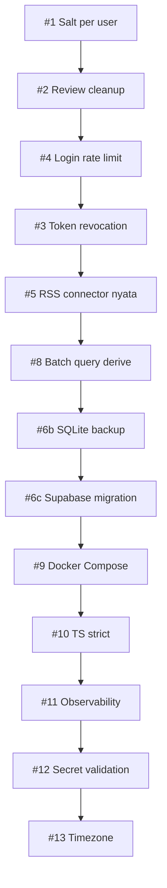

# NARADIG — Fatal Issues Checklist

> Sumber: `FATAL_ISSUES.md`. Status per 13 Nov 2026: **13/13 diimplementasikan** (refactor modular `backend/app/`).
> Verifikasi: `py_compile` OK, self-check logika (auth, token revoke, rate limit, ingest, clustering, review cleanup, backup) OK.
> **Belum dijalankan:** `pytest` + `npm run build` — dependensi belum terpasang (pip/npm butuh jaringan).

---

## 🔴 KRITIS — Keamanan & Integritas Data (Selesai)

| # | Isu | Lokasi baru | Status | Catatan |
|---|-----|-------------|--------|---------|
| 1 | Salt statis password → salt per user | `app/security.py:14` | ✅ | PBKDF2 120k + salt acak; hash lama dimigrasi saat login sukses |
| 2 | Review orphan saat re-analisis | `app/analysis.py:70` | ✅ | Review dihapus sebelum klaster lama dihapus |
| 3 | Token tidak bisa dicabut | `app/security.py:46` + `POST /auth/logout` | ✅ | Tabel `revoked_tokens` (jti), cek di `_decode` |
| 4 | Login rate limit (brute force) | `app/security.py:76`, `app/api.py:69` | ✅ | 5 percobaan / 15 menit per IP+email → 429 |

---

## 🟠 TINGGI — Arsitektur & Skalabilitas (Selesai)

| # | Isu | Lokasi baru | Status | Catatan |
|---|-----|-------------|--------|---------|
| 5 | Konektor hanya mock | `app/connectors.py` | ✅ | RSS/Atom nyata (`NARADIG_RSS_FEEDS`), retry+backoff, fallback korpus demo |
| 6 | SQLite single-file, no migration | `app/db.py` | ✅ | Dual backend: SQLite (default) / PostgreSQL via `DATABASE_URL`, DDL PG + pgvector |
| 6b | Backup otomatis | `app/db.py:backup` | ✅ | Cron 03:00, gzip SQLite (sqlite3 backup API) / `pg_dump`, retensi 7 hari, upload Supabase opsional |
| 6c | Supabase PostgreSQL + pgvector | `app/db.py` + `backend/.env.example` | ✅ | `CREATE EXTENSION IF NOT EXISTS vector`, `psycopg_pool`, env Supabase |
| 7 | Tidak ada queue | `app/queue.py`, `backend/worker.py` | ✅ | Celery+Redis; fallback inline bila Redis/Celery tidak ada |
| 8 | N+1 query clusters/overview | `app/analysis.py:list_clusters` | ✅ | 3 query total (klaster, konten, review) — dibuktikan di test |
| 9 | Tidak ada Docker Compose | `docker-compose.yml`, `*/Dockerfile` | ✅ | db(pgvector)+redis+backend+worker+frontend |

---

## 🟡 SEDANG — Kualitas & Observability (Selesai)

| # | Isu | Lokasi baru | Status | Catatan |
|---|-----|-------------|--------|---------|
| 10 | TypeScript & ESLint dimatikan | `frontend/next.config.js`, `tsconfig.json`, `.eslintrc.json`, `package.json` | ✅ | `strict: true`, ignore-build dihapus, deps eslint ditambahkan |
| 11 | Observability minimal | `app/main.py:access_log` | ✅ | Log JSON per request + `x-request-id`; health konektor (latensi/error) |
| 12 | Secret validation startup | `app/config.py:validate` | ✅ | Produksi tanpa `NARADIG_SECRET`/`DATABASE_URL` → `RuntimeError` |
| 13 | Timezone hardcoded WITA | `frontend/lib/api.ts:fmt` | ✅ | Ikut zona perangkat; label server via `NARADIG_TZ` |

---

## ➕ Tambahan dari permintaan
| Item | Status | Catatan |
|------|--------|---------|
| Retensi/penghapusan data (FR-026) | ✅ | `DELETE /workspaces/{id}` + `DELETE /monitoring-topics/{id}` |
| Graph relasi (FR-019, minimal) | ✅ | `GET /narratives/{cid}/graph` (edge bertipe, tanpa NetworkX) |
| Kesehatan konektor (FR-027) | ✅ | Tabel `connector_health`, tampil di halaman Data Sources |
| Uji runnable | ✅ | `backend/tests/test_core.py` + `tests/conftest.py` |

---

## ⚠️ Yang belum diverifikasi / tersisa

- [ ] `pip install -r requirements.txt` lalu `pytest -q` (butuh jaringan; sandbox offline)
- [ ] `cd frontend && npm install && npm run build` (butuh jaringan)
- [ ] `docker compose up --build` (butuh Docker + jaringan)
- [ ] Embedding multilingual/HDBSCAN, PDF report, konektor YouTube/Reddit (masih backlog SRS)
- [ ] UI graph/network (endpoint siap, visualisasi belum)

---

## 📋 Critical Path 7 Hari (Target)

| Hari | Fokus Utama | Deliverable Testable |
|------|-------------|---------------------|
| 1 | **#1 + #2 + #4** | Login brute force → 429; re-analisis → review lama terhapus |
| 2 | **#3** | Logout → token dicabut, 401 saat reuse |
| 3 | **#5** | RSS nyata fetch → item masuk `contents`, dedupe jalan |
| 4 | **#8 + #6b** | `clusters()` < 500ms (500 klaster); backup file ada di Supabase Storage |
| 5 | **#6c + #9** | `docker-compose up` → backend connect Supabase, pgvector aktif |
| 6 | **#10** | `npm run build` zero error, `strict: true` |
| 7 | **#11 + #12** | Structured log JSON, startup guard fail fast |

---

## 🔗 Dependencies Antar Task



---

## 🎯 Definition of Done per Task

| Task | Done Criteria |
|------|---------------|
| #1 | User baru: hash `salt:hash`; user lama: login tetap jalan (migrasi otomatis) |
| #2 | `POST /workspaces/{wid}/analysis-jobs` → `reviews` table kosong untuk ws tsb |
| #3 | `DELETE /auth/logout` (baru) → token masuk `revoked_tokens` → request berikutnya 401 |
| #4 | 6× login gagal same IP+email → 429 "Terlalu banyak percobaan, coba lagi 15 menit" |
| #5 | `GET /connectors` → RSS nyata `available=true`, `fetch_conn` panggil HTTP real, parse `<item>` |
| #6b | Supabase Storage bucket `naradig-backups` punya `naradig_YYYYMMDD_HHMMSS.db.gz` harian |
| #6c | `psycopg_pool` connect Supabase, `CREATE EXTENSION vector;` jalan, RLS policies aktif |
| #8 | `GET /clusters?workspace_id=X` < 500ms untuk 500 klaster (local test) |
| #9 | `docker-compose up -d` → frontend:3000, backend:8000, db:5432 all healthy |
| #10 | `cd frontend && npm run build` exit 0, no `any` implicit, no `@ts-ignore` |
| #11 | Log JSON per request: `{"ts":"...","req_id":"...","method":"GET","path":"/clusters","dur_ms":12}` |
| #12 | Startup tanpa `NARADIG_SECRET` → `RuntimeError: NARADIG_SECRET wajib di-set` |
| #13 | User di Jakarta/WIB → waktu tampil WIB; user di Makassar/WITA → WITA |

---

## 📝 Catatan Cepat Implementasi

### Hari 1 - Salt + Review + Rate Limit (sekaligus, file sama `main.py`)

```python
# 1. Salt per user
def pw_hash(p: str) -> str:
    salt = os.urandom(16)
    h = hashlib.pbkdf2_hmac("sha256", p.encode(), salt, 60000)
    return salt.hex() + ":" + h.hex()

def pw_verify(p: str, stored: str) -> bool:
    if ":" not in stored:  # hash lama (migrasi)
        return hmac.compare_digest(stored, pw(p))
    salt_hex, h_hex = stored.split(":")
    h = hashlib.pbkdf2_hmac("sha256", p.encode(), bytes.fromhex(salt_hex), 60000)
    return hmac.compare_digest(h.hex(), h_hex)

# 2. Review cleanup (di analyze() sebelum DELETE clusters)
q("DELETE FROM reviews WHERE cluster_id IN (SELECT id FROM clusters WHERE ws=?)", (ws,), write=True)

# 4. Login rate limit
login_bucket = {}
def check_rate(key: str) -> bool:
    now = time.time()
    bucket = [t for t in login_bucket.get(key, []) if now - t < 900]
    if len(bucket) >= 5: return False
    bucket.append(now)
    login_bucket[key] = bucket
    return True

@app.post(P + "/auth/login")
def login(b: Login, request: Request):
    key = f"{request.client.host}:{b.email.lower().strip()}"
    if not check_rate(key): raise HTTPException(429, "Terlalu banyak percobaan, coba lagi 15 menit")
    ...
```

### Hari 4 - Batch Query `derive()` (Pattern)

```python
def clusters_batch(workspace_id: int):
    # 1 query: semua cluster ids
    cluster_ids = [c["id"] for c in q("SELECT id FROM clusters WHERE ws=?", (workspace_id,))]
    if not cluster_ids: return []
    
    # 1 query: semua contents untuk cluster tsb
    placeholders = ",".join("?" * len(cluster_ids))
    contents = q(f"""
        SELECT c.*, cl.id as cluster_id 
        FROM contents c
        JOIN clusters cl ON cl.ws = ? AND cl.id IN ({placeholders})
        WHERE c.ws = ? AND c.id IN (
            SELECT json_each.value FROM clusters, json_each(clusters.items)
            WHERE clusters.ws = ? AND clusters.id IN ({placeholders})
        )
    """, [workspace_id] + cluster_ids + [workspace_id] + [workspace_id] + cluster_ids)
    
    # 1 query: semua reviews
    reviews = {r["cluster_id"]: r for r in q(f"SELECT * FROM reviews WHERE cluster_id IN ({placeholders})", cluster_ids)}
    
    # 1 query: semua evidence (EVID static, bisa cache)
    # ... group by cluster_id di Python, hitung derive() tanpa DB hit
```

---

## 🚫 Out of Scope (Minggu Ini)

- [ ] Embedding multilingual + HDBSCAN
- [ ] Graph relasi (NetworkX + Cytoscape)
- [ ] PDF report generator
- [ ] Konektor YouTube/Reddit API
- [ ] Self-hosted PostgreSQL + PgBouncer
- [ ] Custom object storage

---

## 📌 Next Action

**Hari 1 mulai sekarang:** Buka `backend/main.py`, implementasikan #1, #2, #4 sekaligus. Test:
```bash
# Test salt migrasi
curl -X POST localhost:8000/api/v1/auth/login -d '{"email":"analyst@naradig.local","password":"naradig123"}'

# Test rate limit (6x gagal)
for i in {1..6}; do curl -X POST localhost:8000/api/v1/auth/login -d '{"email":"analyst@naradig.local","password":"salah"}'; done

# Test review cleanup
# 1. Buat workspace, import data, jalankan analisis
# 2. Review salah satu klaster
# 3. Jalankan analisis ulang
# 4. Cek review status → harus "Belum ditinjau" (bukan review lama)
```